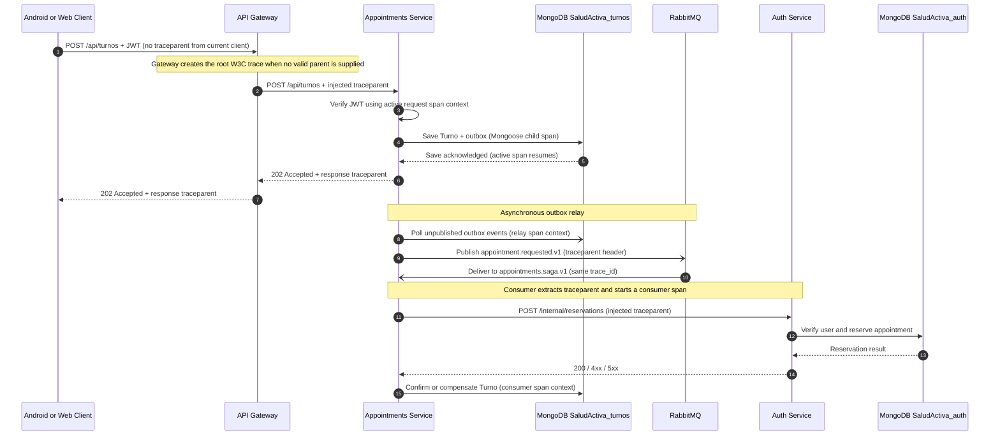

# CP1: Critical Journey and Trace Map

## Selected functionality

**Patient appointment booking and asynchronous saga confirmation.** A signed-in Android or web client submits an appointment request. The Appointments Service persists a `Pendiente` appointment and its `appointment.requested.v1` outbox event before returning `202 Accepted`. A background relay publishes the event to RabbitMQ. The saga consumer asks Auth to reserve the appointment, then confirms the appointment or compensates it.

This is a critical journey because a successful HTTP response means the request was accepted, not that the appointment is already confirmed. The actual state transition is asynchronous.

## Runtime hops

| # | Caller | Receiver | Operation / protocol | Sync or async | Data and persistence |
|---:|---|---|---|---|---|
| 1 | Android app or web client | `api-gateway` | `POST /api/turnos`, HTTPS/REST | Synchronous | Request body and JWT; the current Android client does not create OpenTelemetry context |
| 2 | `api-gateway` | `appointments-service` | Proxied `POST /api/turnos`, HTTP/REST inside Compose | Synchronous | W3C `traceparent` is propagated; no Auth-service call is made on this request path |
| 3 | `appointments-service` | Appointments MongoDB (`SaludActiva_turnos`) | Verify JWT locally, save `Turno` with `sagaStatus=PENDING` and `appointment.requested.v1` outbox record | Synchronous | The appointment and outbox event are written in the same MongoDB document |
| 4 | `appointments-service` outbox relay | RabbitMQ `salud-activa.events.v1` | Publish `appointment.requested.v1` to `appointments.saga.v1` | Asynchronous | Polls unpublished outbox events; message is persistent and includes the stored `traceparent` |
| 5 | RabbitMQ | Appointments saga consumer | Deliver event over AMQP | Asynchronous | Consumer extracts W3C context from AMQP message headers |
| 6 | `appointments-service` saga consumer | `auth-service` | `POST /internal/reservations`, HTTP/REST | Asynchronous relative to the original client request; synchronous within the consumer | Auth checks the user and idempotently creates a reservation in `SaludActiva_auth` |
| 7 | Saga consumer | Appointments MongoDB | Confirm or compensate the appointment; append a result outbox event | Asynchronous | Sets `COMPLETED` / `Confirmado` or `COMPENSATED` / `Cancelado` |

There is no notification service in the current runtime. The request route returns after the appointment/outbox save; broker publishing, reservation, and final state transition continue in the background.

## Sequence



## Span tree

The expected tree below follows the W3C parent context. Automatic HTTP, Express, Mongoose, and AMQP spans depend on the configured SDK and exporter; without an OTLP endpoint they are not visible in a trace UI.

```text
api-gateway: POST /api/turnos (SERVER, root if client has no traceparent)
└── appointments-service: POST /api/turnos (SERVER)
    ├── mongoose: save Turno + outbox (CLIENT)
    └── outbox relay: publish appointment.requested.v1 (PRODUCER)
        └── appointments.saga.process (CONSUMER; same trace_id, message traceparent parent)
            ├── auth-service: POST /internal/reservations (HTTP CLIENT)
            │   └── auth-service: POST /internal/reservations (HTTP SERVER)
            │       └── mongoose: reserve in SaludActiva_auth (CLIENT)
            └── mongoose: transition Turno and append result event (CLIENT)
```

## Correlation and trace context

- The backend initializes the OpenTelemetry Node SDK before loading Express. The gateway starts a W3C server span; if the caller supplies a valid `traceparent`, it is extracted instead of starting an unrelated trace.
- The HTTP middleware returns the active server span as a W3C `traceparent` response header.
- The gateway injects the active OpenTelemetry context into its proxy request headers. Each backend HTTP service extracts it and creates a server span with the incoming trace as parent.
- On accepting a booking, Appointments injects the active W3C context into the outbox record's `traceparent` field. The relay puts it in the RabbitMQ message headers. The saga consumer extracts it and creates `appointments.saga.process` as a consumer span, so the asynchronous work retains the original `trace_id`.
- The Auth HTTP call runs within the consumer context; HTTP client instrumentation propagates that context to Auth.
- `appointment_id` is the stable business correlation key; `event_id` identifies a particular outbox event. They may appear in structured logs, but never in Prometheus labels.
- With no `OTEL_EXPORTER_OTLP_ENDPOINT` (or `OTEL_EXPORTER_OTLP_TRACES_ENDPOINT`), spans and context propagation are active but spans are not exported to a trace backend. The startup warning makes that limitation visible.
