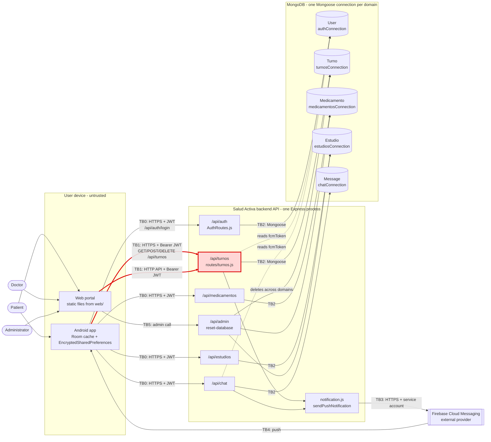

# CP1 — Attack Surface Map: Salud Activa

Sources: `05-architecture/overview.md`, `09-microservices/service-catalog.md`,
`09-microservices/dependency-map.md`, `09-microservices/data-ownership-matrix.md`,
`09-microservices/event-catalog.md` and `07-api/authentication-appt-mgmt.md` of the team -docs.

The map shows the **current runtime**: one Node.js/Express process (`backend/server.js`,
default `PORT` 10000) that mounts every route module and opens one Mongoose connection per
domain. The six domain microservices of `05-architecture/overview.md` are still proposals,
so they are not drawn as separate nodes. There is **no message broker** today
(`event-catalog.md`); the only asynchronous path is the direct call to Firebase Cloud Messaging.

## Data-flow diagram

My boundary is **TB1** (red).

## Trust boundaries

| ID | From (less trusted) | To (more trusted) | Notes |
|----|---------------------|-------------------|-------|
| TB0 | Android app / web portal | `/api/auth`, `/api/medicamentos`, `/api/estudios`, `/api/chat` | Public internet; teammates' boundaries |
| **TB1** | **Android app / web portal** | **`/api/turnos` (appointment module)** | **Mine — inbound** |
| TB2 | Express process | MongoDB connections | Credentials from `MONGODB_URI` / `dbConnections.js` |
| TB3 | `notification.js` | Firebase Cloud Messaging | External API, Firebase Admin service account |
| TB4 | FCM | Android device | Push payload leaves our control |
| TB5 | Web client | `/api/admin/reset-database` | Cross-domain delete, highest privilege |

## Asset inventory (appointment domain)

| Asset | Where it lives | Classification |
|-------|----------------|----------------|
| `Turno` record: patient name, reason, specialty, doctor, date/time | `turnosConnection`, in transit on TB1, Room cache | Restricted (health data) |
| JWT access token (60 min) | `Authorization` header on TB1, `EncryptedSharedPreferences` | Restricted |
| `User.fcmToken` | `authConnection`, read by `routes/turnos.js` | Confidential |
| Patient identifier (`User` id / `sub` claim) | JWT claims, `Turno.userId` field | Confidential |
| Doctor agenda / slot availability | `turnosConnection` (computed from `Turno` records) | Internal |
| Specialty catalog | backend, Android UI | Public |
| JWT signing key and Mongo credentials | backend environment variables | Restricted |

## Entry points of TB1

Exact paths must match `backend/routes/turnos.js`; the list below follows
`service-catalog.md` ("list, check availability, create, cancel").

| Entry point | Caller | Authentication today |
|-------------|--------|----------------------|
| `GET /api/turnos` — list my appointments | Android app (Retrofit), web portal | `authMiddleware`, Bearer JWT |
| Availability check route in `routes/turnos.js` | Android app before booking | Bearer JWT (to verify per route) |
| `POST /api/turnos` — create appointment (critical endpoint, NFR-001) | Android app, web portal | `authMiddleware`, Bearer JWT |
| `DELETE /api/turnos/:id` — cancel (deletes the `Turno` record) | Android app, web portal | `authMiddleware`, Bearer JWT; ownership check not evidenced |
| TCP port `PORT` (default 10000) of the Express process | Any internet client | TLS terminated in front of the process (AWS ALB per NFR-004, not verified) |

Gap: `07-api/authentication-appt-mgmt.md` specifies RS256 + JWKS, but
`02-auth-service/decisions.md` says gateway token verification and a token blacklist are
not evidenced in the current code. TB1 relies only on the route middleware.
