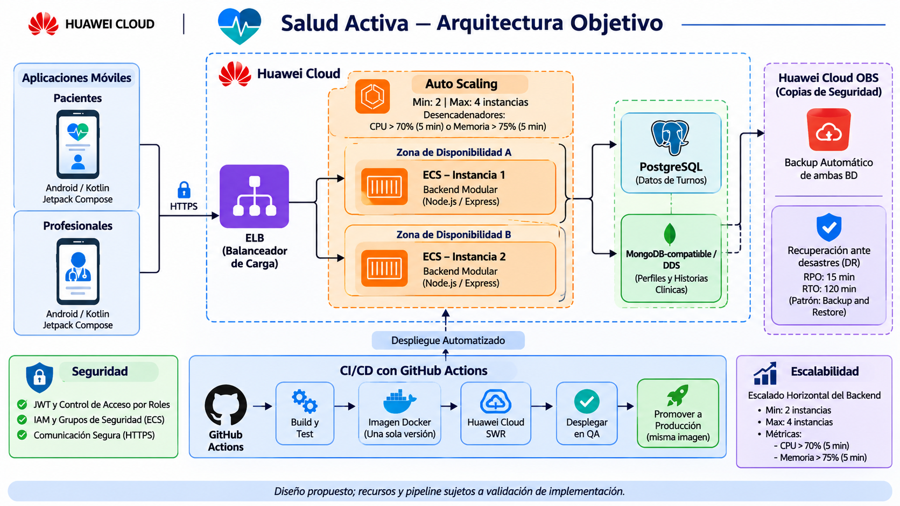

# Architecture Design Note — Salud Activa

## 1. Target architecture

  

The target architecture for Salud Activa is based on a modular backend that centralizes the main business functionalities in one Node.js/Express application. The system follows a modular organization in which appointments, medication, medical studies, chat, identity, and administration maintain their own functional responsibilities without being deployed as independent microservices at this stage.

The mobile application provides the main interface for patients and healthcare professionals. The backend receives requests through a load balancer and distributes traffic between two application instances deployed across separate availability zones. This configuration is intended to improve availability and provide a foundation for horizontal scaling.

The proposed Huawei Cloud infrastructure separates application execution, database storage, container image management, and backup storage. The backend image is stored in Software Repository for Container (SWR), allowing the same version to be promoted from the QA environment to production.

The architecture is a target design and does not mean that all Huawei Cloud resources are already deployed.

| **Component in the diagram** | **Defined in (file of your team's -docs)** |
| ----------------------------- | ------------------------------------------- |
| Mobile application (Android / Kotlin / Jetpack Compose) | `05-architecture/overview.md` |
| Modular backend (Node.js / Express) | `09-microservices/service-catalog.md` |
| Appointments and business modules | `09-microservices/service-catalog.md` |
| Load balancer (ELB) | `05-architecture/overview.md` |
| Application instances (ECS) | `05-architecture/overview.md` |
| PostgreSQL database (appointments) | `05-architecture/overview.md` |
| Document database (MongoDB-compatible / DDS) | `05-architecture/overview.md` |
| Container image repository (SWR) | `10-devops/ci-cd.md` |
| Object Storage Service (OBS) for backups | `10-devops/ci-cd.md` |

## 2. Five principles

| **Principle** | **Current weakness** | **Evidence in -docs** | **Design decision** | **Huawei Cloud service** |
| -------------- | -------------------- | --------------------- | ------------------- | ------------------------ |
| Reliability | The current backend is organized as one application, so a process failure can affect several functional modules. | `09-microservices/service-catalog.md` | Deploy two backend instances across different availability zones behind a load balancer to reduce the impact of an individual instance failure. | ELB and ECS |
| Security | The application requires consistent authentication, authorization, and protection of communication between clients and backend resources. | `05-architecture/overview.md` | Apply JWT-based authentication, role-based access control, HTTPS communication, and restricted access to infrastructure resources. | IAM, ECS Security Groups and ELB |
| Performance efficiency | All functional modules share the same backend deployment, which can create resource competition when the number of simultaneous requests increases. | `09-microservices/service-catalog.md` | Monitor CPU, memory, and request load, and increase the number of backend instances when the defined thresholds are exceeded. | ECS and Auto Scaling |
| Cost | Deploying independent services for every functional module would increase infrastructure consumption and operational expenses. | `09-microservices/service-catalog.md` | Maintain one modular backend as the initial deployment unit and use automatic scaling instead of permanently provisioning unnecessary resources. | ECS and Auto Scaling |
| Operations | Building images separately for different environments can produce inconsistent versions and complicate application rollbacks. | `10-devops/ci-cd.md` | Build the backend image once, store it in SWR, promote the same version through QA and production, and retain previous versions for rollback. | SWR and ECS |

The five principles guide the infrastructure decisions for the academic target. Reliability focuses on reducing service interruptions, while security protects application access and infrastructure resources. Performance efficiency allows the backend to respond to increasing workloads without requiring an immediate architectural separation of its modules.

Cost efficiency is addressed by keeping a single deployment unit during the initial stage. This avoids introducing additional services before there is a measurable technical need. Operations focuses on making deployments repeatable and ensuring that the same application artifact is tested before reaching production.

These decisions provide a balance between availability, security, performance, cost, and maintainability.

## 3. Scalability

The initial scalability strategy is based on horizontal scaling of the modular backend. Since the application is deployed as one unit, scaling affects the complete backend rather than individual functional modules.

The proposed infrastructure starts with two application instances distributed across two availability zones. Additional instances can be provisioned when resource consumption increases. The following values are initial design targets and must be validated through load testing before production implementation.

| **Service** | **Scaling metric** | **Threshold (number and unit)** | **Min instances** | **Max instances** |
| ------------ | ------------------ | ------------------------------- | ----------------- | ----------------- |
| Modular Backend (Node.js/Express) | Average CPU utilization | Above 70% for 5 minutes | 2 | 4 |
| Modular Backend (Node.js/Express) | Average memory utilization | Above 75% for 5 minutes | 2 | 4 |

The scaling policy will monitor resource consumption across the backend instances. When CPU or memory utilization remains above the established threshold, the infrastructure can increase the number of running instances. When the workload decreases, instances can be reduced while maintaining the minimum availability requirement.

The minimum of two instances is intended to avoid depending on a single application instance. The maximum of four instances establishes an initial resource limit that helps control infrastructure expenses.

Database scaling must be evaluated separately because increasing application instances does not automatically increase database capacity. Database performance will be monitored through connection usage, query response times, and resource consumption.

## 4. Disaster recovery

- Critical data store: PostgreSQL for appointment information and the MongoDB-compatible document database for profile and medical record information. Both stores must be included in the recovery strategy.
- RTO: 120 minutes.
- RPO: 15 minutes.
- DR pattern (chapter 11): Backup and Restore (backup-based disaster recovery).
- Why the pattern meets those numbers:

The proposed disaster recovery strategy uses automated database backups and additional backup copies stored in Huawei Cloud OBS. The objective is to protect the information required by the main business functionalities and provide a recovery procedure when a database or infrastructure failure occurs.

PostgreSQL and the document database must have independent backup and restoration procedures according to their respective database capabilities. Backup schedules and transaction-log or equivalent recovery mechanisms must be configured to support the proposed 15-minute recovery point objective.

If a failure occurs, the recovery process will involve provisioning or restoring the required database instances, recovering the latest available backups, applying the available transaction logs when supported, reconnecting the backend application, and validating the main business operations.

The RPO of 15 minutes defines the maximum acceptable amount of recent data that could be lost. The RTO of 120 minutes defines the maximum time allowed to restore the service.

This approach avoids the additional cost of maintaining permanently active standby database instances. However, backup integrity and restoration times must be verified through periodic recovery exercises. These values are proposed targets and require technical validation against the selected Huawei Cloud database services.

## 5. Automated deployment

The deployment strategy follows a continuous integration and delivery process. Its main objective is to build, test, store, and deploy the modular backend consistently across QA and production.

The process uses the existing Git branching workflow and Docker containerization. Huawei Cloud SWR acts as the container image repository, allowing the same version to be reused in different environments.

| **Stage** | **Trigger** | **Tool or service** | **File in your team's repositories** |
| ---------- | ----------- | ------------------- | ------------------------------------ |
| Build | Changes pushed or pull request opened | GitHub Actions and Node.js | `.github/workflows/` (workflow to confirm) |
| Test | Build completed and pull request validation | GitHub Actions and automated tests | `.github/workflows/` (test workflow to confirm) |
| Image | Changes merged into `qa` | Docker and Huawei Cloud SWR | `Dockerfile` |
| Deploy to qa | New version successfully published to SWR | SWR and ECS | `10-devops/ci-cd.md` |
| Deploy to production | QA validation completed and release approved | SWR and ECS | `10-devops/ci-cd.md` |
| Rollback | Deployment failure or production incident | Previous SWR image tag and ECS | `10-devops/ci-cd.md` |

The build stage prepares the backend application and installs its required dependencies. The test stage checks the application before the image is released. Once the changes are accepted into the QA branch, Docker builds the backend image and publishes it to SWR using a versioned tag.

The QA environment receives this image first. After the team validates the application and confirms that the main functionalities work correctly, the same image is promoted to production. This prevents differences between the version tested in QA and the version running in production.

If a deployment introduces an unexpected problem, the previous image can be selected from SWR and deployed again. This rollback strategy avoids rebuilding an older version from source code and reduces recovery effort.

The pipeline must also manage environment variables and sensitive configuration separately from the container image. Credentials and production secrets must not be stored directly in the repository or included in the image.

The workflow files and deployment configuration must be confirmed in the application repository before claiming that the complete pipeline is operational.

## 6. Decisions

- [ADR-C3-01](https://github.com/ElDavid499/sistemas-distribuidos-2026-b-g2/blob/main/certification/design/ADR-C3-01.md): Keep the Modular Backend as the First Deployment Unit. This decision establishes Node.js/Express as one initial deployment unit, with two proposed application instances across availability zones, avoiding the premature separation of functional modules into independent microservices.

- [ADR-C3-02](https://github.com/ElDavid499/sistemas-distribuidos-2026-b-g2/blob/main/certification/design/ADR-C3-02.md): Build Once and Promote the Backend Image Using SWR. This decision establishes a consistent container image strategy in which the backend image is built once, stored in Huawei Cloud SWR, validated in QA, and promoted to production without rebuilding it.

Both decisions support the proposed architecture by reducing deployment complexity, maintaining consistency between environments, and providing a foundation for future improvements in availability, scalability, and operations.
